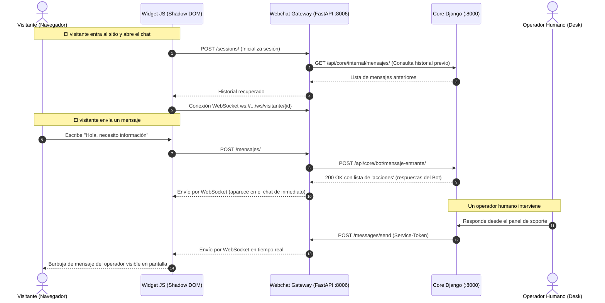

# 💬 Canal Webchat - Plataforma Multicanal de Chatbot

Microservicio de pasarela (**Channel Gateway**) y **Widget Web Embebible** para la plataforma de atención automatizada y derivación con operadores humanos.

Permite a cualquier organización (por ejemplo, sitios universitarios o e-commerce) incrustar una burbuja de chat flotante en su página web mediante una sola etiqueta `<script>`, comunicándose de forma bidireccional y en tiempo real con el motor central (**Core** en Django).

---

## 📑 Tabla de Contenidos
1. [Características Principales](#-características-principales)
2. [Arquitectura y Flujo de Comunicación](#-arquitectura-y-flujo-de-comunicación)
3. [Tecnologías y Requisitos](#-tecnologías-y-requisitos)
4. [Instalación y Puesta en Marcha Local](#-instalación-y-puesta-en-marcha-local)
5. [Ejecución en 1 Clic con VS Code](#-ejecución-en-1-clic-con-vs-code-f5)
6. [Cómo Probar el Chatbot](#-cómo-probar-el-chatbot)
7. [Cómo Incrustar el Widget en Sitios Web](#-cómo-incrustar-el-widget-en-sitios-web)
8. [Integración con la App Principal (Core Django)](#-integración-con-la-app-principal-core-django)
9. [¿Cómo y Por Qué Funciona el WebSocket?](#-cómo-y-por-qué-funciona-el-websocket)
10. [Estructura del Proyecto](#-estructura-del-proyecto)

---

## 🚀 Características Principales

- **Widget Ultra Liviano y Aislado (Shadow DOM):** Desarrollado en Vanilla JavaScript sin dependencias externas (no requiere React ni librerías pesadas). Los estilos están encapsulados con Shadow DOM para no interferir ni ser afectados por el CSS de la página anfitriona.
- **Identidad Persistente del Visitante:** Genera y almacena un `visitor_id` en `localStorage` para conservar la sesión del usuario entre recargas de página.
- **Comunicación en Tiempo Real con WebSockets:** Conexión persistente full-duplex para recibir respuestas del bot y de operadores humanos al instante.
- **Backend Asíncrono de Alto Rendimiento:** Construido sobre **FastAPI** y servidores ASGI (**Uvicorn** / **Gunicorn**).
- **Seguridad Inter-Servicios:** Autenticación por cabecera `Authorization: Service-Token <token>` mediante comparación de tiempo constante (`hmac.compare_digest`) para prevenir ataques de temporización.
- **CORS Configurable:** Permite que cualquier dominio autorizado incruste el widget de forma segura.

---

## 🏗 Arquitectura y Flujo de Comunicación



---

## 🛠 Tecnologías y Requisitos Instalación

### Requisitos del Sistema
- **Python:** Versión `3.10` o superior (probado en Python `3.11`, `3.12` y `3.14`).
- **Navegador Web:** Chrome, Firefox, Edge, Safari u Opera con soporte estándar para WebSockets y Shadow DOM.
- **Git** instalado en el sistema.
- **Docker y Docker Compose** (opcional, para despliegues en contenedores).

### Dependencias de Python (`requirements.txt`)
| Librería | Versión | Rol |
| :--- | :--- | :--- |
| `fastapi` | `0.115.0` | Framework web backend asíncrono y enrutador |
| `uvicorn[standard]` | `0.30.6` | Servidor ASGI de desarrollo con auto-reload |
| `httpx` | `0.27.2` | Cliente HTTP asíncrono para comunicarse con Core |
| `gunicorn` | `23.0.0` | Servidor WSGI/ASGI de producción |

---

## 💻 Instalación y Puesta en Marcha Local

Sigue estos pasos en tu computadora:

### Paso 1: Clonar el Repositorio
```bash
git clone https://github.com/cm-ale/ChatBot.git
cd ChatBot
```

### Paso 2: Entrar a la carpeta del servicio
```bash
cd services/webchat
```

### Paso 3: Crear el Entorno Virtual
- **En Windows:**
  ```powershell
  python -m venv venv
  ```
- **En macOS / Linux:**
  ```bash
  python3 -m venv venv
  ```

### Paso 4: Activar el Entorno Virtual
- **En Windows (PowerShell):**
  ```powershell
  .\venv\Scripts\activate
  ```
  *(Si te sale un error de scripts deshabilitados en PowerShell, ejecuta primero: `Set-ExecutionPolicy -Scope Process -ExecutionPolicy Bypass` y vuelve a activar).*
- **En Windows (CMD tradicional):**
  ```cmd
  venv\Scripts\activate.bat
  ```
- **En macOS / Linux:**
  ```bash
  source venv/bin/activate
  ```
*(Sabrás que está activo porque aparecerá `(venv)` al inicio de la terminal).*

### Paso 5: Instalar Dependencias
```bash
pip install -r requirements.txt
```

### Paso 6: Iniciar el Servidor
```bash
uvicorn app.main:app --host 0.0.0.0 --port 8006 --reload
```

---

## ⚡ Ejecución en 1 Clic con VS Code (F5)

El proyecto incluye la configuración en `.vscode/launch.json` y `.vscode/settings.json`.

1. Abre la carpeta del proyecto en **VS Code**.
2. Presiona la tecla **`F5`** (o ve a la pestaña *Run and Debug* 🐞 y haz clic en el botón verde de **Play ▶️**).
3. VS Code levantará el servidor utilizando el entorno virtual y **abrirá automáticamente la demo en tu navegador**.

---

## 🌐 Cómo Probar el Chatbot

Una vez levantado el servidor en el puerto `8006`:

1. **Página de Prueba Visual (Demo del Cliente):**  
   👉 **[http://localhost:8006/demo](http://localhost:8006/demo)**  
   *Muestra una aplicación web con el widget incrustado en la esquina inferior derecha. Puedes hacer clic, desplegar la ventana y enviar mensajes.*

2. **Documentación Swagger Interactiva:**  
   👉 **[http://localhost:8006/docs](http://localhost:8006/docs)**  
   *Explora y ejecuta peticiones contra todos los endpoints REST directamente desde el navegador.*

3. **Chequeo de Estado (Healthcheck):**  
   👉 **[http://localhost:8006/health](http://localhost:8006/health)**  
   *Devuelve un JSON con el estado del servicio y la URL configurada de Core.*

---

## 🧩 Cómo Incrustar el Widget en Sitios Web

Para integrar el chat en cualquier sitio web externo (HTML estático, WordPress, React, Django, etc.), solo se debe pegar la siguiente etiqueta antes de la etiqueta de cierre `</body>`:

```html
<script src="http://localhost:8006/static/widget.js"
        id="webchat-script"
        data-org-id="7"
        data-api-url="http://localhost:8006"
        data-color="#1e40af"
        data-title="Atención al Cliente"
        defer></script>
```

### Atributos Configurables (`data-*`):
| Atributo | Obligatorio | Descripción | Ejemplo |
| :--- | :---: | :--- | :--- |
| `data-org-id` | Sí | ID numérico de la organización cliente en Core | `"7"` |
| `data-api-url` | Sí | URL base donde está corriendo el servicio Webchat | `"http://localhost:8006"` |
| `data-color` | No | Color primario del tema del widget (hexadecimal o CSS) | `"#1e40af"` |
| `data-title` | No | Título mostrado en el encabezado de la ventana de chat | `"Atención al Alumno"` |

---

## 🔗 Integración con la App Principal (Core Django)

Para conectar este microservicio con el Core de la plataforma, se deben coordinar las siguientes configuraciones y archivos:

### 1. Variables de Entorno en `webchat`
Se pueden configurar mediante un archivo `.env` o en el entorno del sistema:
- `CORE_URL`: URL base del servicio Core (por defecto `http://core:8000` en Docker o `http://localhost:8000` en local).
- `CORE_SERVICE_TOKEN`: Token compartido para validar que las peticiones entre microservicios son legítimas.
- `PORT`: Puerto de escucha del servicio (por defecto `8006`).
- `CORS_ORIGINS`: Lista separada por comas de orígenes permitidos (por defecto `*`).

---

### 2. Archivos a modificar en la App Principal (Core)

#### A. En `docker-compose.yml`
Agregar el servicio en la red compartida del monorepo:
```yaml
webchat:
  build:
    context: ./services/webchat
    dockerfile: Dockerfile
  profiles: ["webchat"]
  ports:
    - "8006:8006"
  environment:
    - CORE_URL=http://core:8000
    - CORE_SERVICE_TOKEN=${WEBCHAT_SERVICE_TOKEN}
    - DB_SCHEMA=webchat
    - PORT=8006
  depends_on:
    - core
    - postgres
```

#### B. En `services/core/conversations/webchat_client.py` (Nuevo Cliente de Salida)
Permite a Core enviar mensajes hacia Webchat cuando un operador humano responde desde el *Operators Desk*:
```python
import logging
import requests
from django.conf import settings
from platform_admin.models import ServiceToken

logger = logging.getLogger(__name__)

def enviar_mensaje_webchat(visitor_id: str, texto: str) -> bool:
    webchat_url = getattr(settings, "WEBCHAT_SERVICE_URL", "http://webchat:8006")
    endpoint = f"{webchat_url}/messages/send"
    
    token_obj = ServiceToken.objects.filter(
        servicio=ServiceToken.Servicio.WEBCHAT, 
        activo=True
    ).first()
    
    if not token_obj or not token_obj.token_plano:
        logger.error("[WebchatClient] No se encontró ServiceToken activo para WEBCHAT")
        return False

    headers = {
        "Authorization": f"Service-Token {token_obj.token_plano}",
        "Content-Type": "application/json"
    }
    payload = {"visitor_id": visitor_id, "texto": texto}

    try:
        response = requests.post(endpoint, json=payload, headers=headers, timeout=5)
        return response.status_code == 200
    except requests.RequestException as e:
        logger.error(f"[WebchatClient] Error enviando mensaje a webchat: {e}")
        return False
```

#### C. En `services/core/conversations/internal_views.py` (Historial de Mensajes)
Vista interna para que el visitante recupere sus mensajes al recargar la página:
```python
from rest_framework.views import APIView
from rest_framework.response import Response
from rest_framework import status
from platform_admin.service_auth import ServiceTokenAuthentication
from conversations.models import Contacto, Conversacion, Mensaje

class InternalHistorialMensajesView(APIView):
    authentication_classes = [ServiceTokenAuthentication]
    permission_classes = []

    def get(self, request):
        org_id = request.query_params.get("organization_id")
        canal = request.query_params.get("canal")
        contact_externo_id = request.query_params.get("contact_externo_id")

        if not all([org_id, canal, contact_externo_id]):
            return Response({"error": "Faltan parámetros"}, status=status.HTTP_400_BAD_REQUEST)

        contacto = Contacto.objects.filter(
            organization_id=org_id,
            canal=canal,
            identificador_externo=contact_externo_id
        ).first()

        if not contacto:
            return Response({"mensajes": []})

        conversacion = Conversacion.objects.filter(contacto=contacto).order_by("-fecha_creacion").first()
        if not conversacion:
            return Response({"mensajes": []})

        mensajes_qs = Mensaje.objects.filter(conversacion=conversacion).order_by("fecha_envio")[:50]
        
        historial = [
            {
                "id": m.id,
                "origen": "visitante" if m.es_entrante else "bot",
                "texto": m.texto,
                "fecha": m.fecha_envio.isoformat()
            }
            for m in mensajes_qs
        ]

        return Response({"mensajes": historial})
```

Registrar la ruta en `services/core/conversations/urls.py`:
```python
path("api/core/internal/mensajes/", InternalHistorialMensajesView.as_view(), name="internal-historial"),
```

---

## 📡 ¿Cómo y Por Qué Funciona el WebSocket?

En un chat convencional, la web funciona con **HTTP** (el navegador pregunta y el servidor responde). Sin embargo, cuando un **operador humano** atiende a un usuario:
1. El usuario está inactivo en la web leyendo la pantalla.
2. El operador en el panel de soporte responde 2 minutos después.
3. Con HTTP normal, el servidor no puede avisarle al usuario sin hacer peticiones continuas ("polling") que saturan el servidor y gastan batería.

### La solución: WebSocket
- Al abrir la página, el widget establece una conexión persistente: `ws://localhost:8006/ws/visitante/{visitor_id}`.
- El servidor mantiene en memoria un mapa de sockets activos (`visitor_id` $\rightarrow$ `WebSocket`).
- Cuando Core invoca `POST /messages/send`, Webchat ubica el socket de ese visitante y le transmite el mensaje de inmediato (tiempo de entrega inferior a 10 milisegundos).

---

## 📁 Estructura del Proyecto

```text
Chatbot/
├── .vscode/
│   ├── launch.json              # Configuración de ejecución y debug (F5)
│   └── settings.json            # Intérprete de Python por defecto
├── GUIA_INTEGRACION_CORE.md     # Documentación técnica de integración con Core
├── README.md                    # Esta documentación
└── services/
    └── webchat/
        ├── app/
        │   ├── __init__.py      # Paquete principal
        │   ├── config.py        # Carga de variables de entorno (Settings)
        │   ├── connection_manager.py # Administrador de conexiones WebSocket
        │   ├── core_client.py   # Cliente HTTP asíncrono hacia Core (Django)
        │   ├── internal_auth.py # Validación de Service-Token de seguridad
        │   ├── main.py          # Punto de entrada FastAPI, CORS y estáticos
        │   ├── schemas.py       # Modelos de datos Pydantic para requests/responses
        │   └── routes/
        │       ├── __init__.py  # Subpaquete de rutas
        │       ├── message_routes.py   # Endpoints de mensajes (visitante y operador)
        │       ├── session_routes.py   # Endpoint de inicialización de sesión
        │       └── websocket_routes.py # Endpoint del canal WebSocket
        ├── static/
        │   └── widget.js        # Script del widget embebible en Vanilla JS (Shadow DOM)
        ├── requirements.txt     # Dependencias de Python
        └── test_client.html     # Página web de prueba del cliente
```
